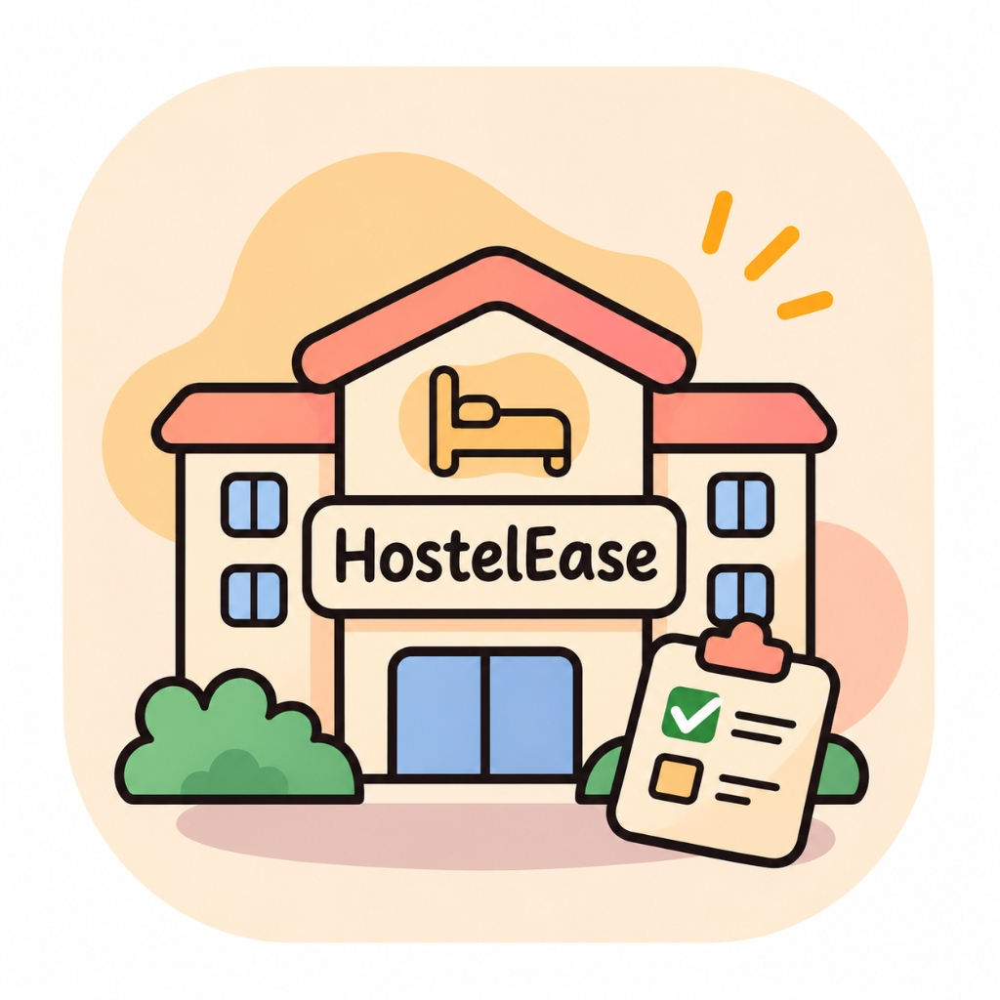
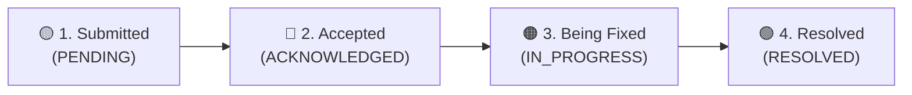
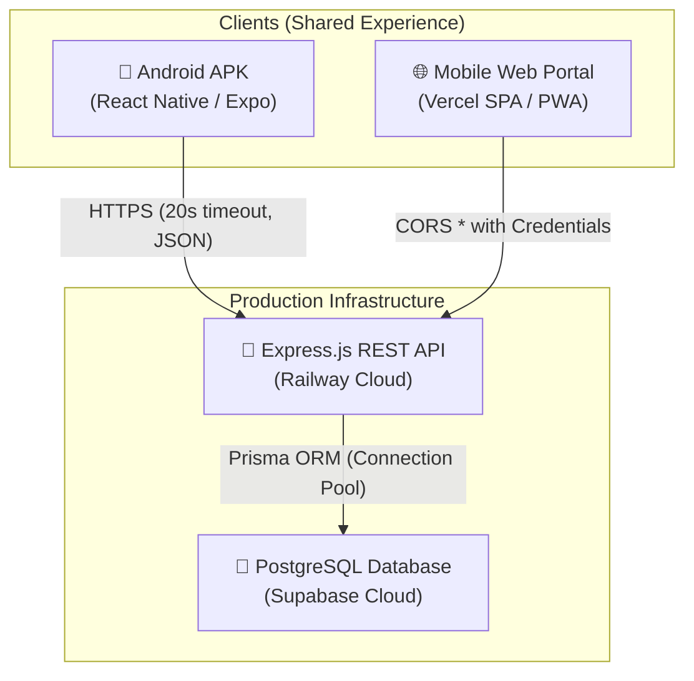

<div align="center">



# 🏨 HostelEase
### Next-Generation Smart Hostel Management System

[](https://hostelease1-web.vercel.app/)
[](https://hostelease1-production.up.railway.app/health)
[](https://expo.dev/)
[](https://reactnative.dev/)
[](https://nodejs.org/)
[](https://supabase.com/)
[](LICENSE)

<br/>

**A unified, cross-platform ecosystem designed to digitize university hostel administration.**  
Available as an **Android APK**, **iOS app**, and a responsive **Live Mobile Web Portal** sharing the exact same real-time database.

<br/>

👉 **[Launch Live Web Portal (Login & Register)](https://hostelease1-web.vercel.app/)** 👈

</div>

---

## 📑 Table of Contents
- [✨ Key Features](#-key-features)
- [🏢 Hostel & Location Hierarchy](#-hostel--location-hierarchy)
- [🛠️ Complaint Resolution Lifecycle](#️-complaint-resolution-lifecycle)
- [🏗️ System Architecture](#️-system-architecture)
- [🔑 Live Demo Credentials](#-live-demo-credentials)
- [📡 API Documentation](#-api-documentation)
- [💻 Tech Stack](#-tech-stack)
- [🚀 Local Setup & Installation](#-local-setup--installation)
- [📦 Building the Android APK](#-building-the-android-apk)
- [🌐 Web Deployment](#-web-deployment)

---

## ✨ Key Features

### 👨‍🎓 Student Experience
- **Smart Registration**: Chip-based hostel selector with conditional block selection and strict numeric room validation (`/^\d{1,4}$/`).
- **Complaint Management**: Auto-fills hostel/block/room from user profile, category chips (*Electrical, Civil, Mess, Internet / Wi-Fi, Other*), and live 4-step progress tracker.
- **7-Day Mess Menu**: Interactive Monday-to-Sunday weekly meal schedule (Breakfast, Lunch, Snacks, Dinner) with 1-tap rating and feedback.
- **Digital Leave Passes**: Submit instant out-pass and overnight leave requests with live approval tracking.
- **Democratic Polls**: Vote on hostel decisions, food options, and campus events with instant percentage tallies.
- **Campus Marketplace & Lost/Found**: Buy/sell textbooks, electronics, and report missing items securely.
- **Profile Management**: Update hostel, block, and room number on the fly via `PUT /api/users/me`.

### 🛡️ Warden & Admin Experience
- **Role-Based Control**: Dedicated administrative dashboard guarded by server-side role validation.
- **Complaint Action Center**: Filter complaints by hostel and category, inspect room details, and advance status:
  $$\text{Submitted} \longrightarrow \text{Accepted} \longrightarrow \text{Being Fixed} \longrightarrow \text{Resolved}$$
- **Leave Request Approvals**: 1-click Approve or Reject with instant status reflection on student devices.
- **Mess Menu Master**: Modify daily meal items, timings, and monitor student quality ratings.
- **Poll Creation & Management**: Publish campus-wide or hostel-specific polls with customizable options.

---

## 🏢 Hostel & Location Hierarchy

All hostels, blocks, and floor configurations are centrally governed by the single source of truth:

| Hostel Name | Blocks | Floors | Capacity / Rooms |
|:---|:---:|:---:|:---|
| **CVR** | *None* | Floors 0–7 | 28 rooms per floor |
| **Aryabhatta** | Blocks A, B, C, D | Floors 0–7 | 32 rooms per floor |
| **Kalam** | Blocks A, B, C, D | Floors 0–7 | 37 rooms per floor |
| **Asima** | Blocks A, B, C, D | Floors 0–4 (5 floors) | Standard residential blocks |

> [!NOTE]
> **Block Validation Rule**: Selecting **Aryabhatta**, **Kalam**, or **Asima** strictly mandates block selection (`A`–`D`). Selecting **CVR** automatically clears and hides the block requirement. Room numbers are optional and restricted to up to 4 digits (`0`–`9999`).

---

## 🛠️ Complaint Resolution Lifecycle

Every student complaint is tracked across a transparent 4-stage pipeline with the custom `ComplaintTracker` UI component:



- **Submitted (`PENDING`)**: Complaint filed by student with photo and description.
- **Accepted (`ACKNOWLEDGED`)**: Warden acknowledges issue and dispatches maintenance team.
- **Being Fixed (`IN_PROGRESS`)**: Technicians actively working on site.
- **Resolved (`RESOLVED`)**: Work completed and verified.

---

## 🏗️ System Architecture



---

## 🔑 Live Demo Credentials

You can test the live application directly on **[https://hostelease1-web.vercel.app/](https://hostelease1-web.vercel.app/)** or via the Android APK using these pre-configured accounts:

### 👑 Admin / Warden Access
- **Email**: `admin_launch@hostelease.com` *(or `preinfinty.ak@gmail.com`)*
- **Password**: `Password@123`
- **Privileges**: Manage complaints (Accept/Progress/Resolve), Approve leaves, Update mess menus, Create polls.

### 🎓 Student Access
- **Email**: Any student account or register a new account on the registration screen.
- **Example**: `student@hostelease.com` / `Password@123`
- **Privileges**: Apply for complaints, view 4-stage tracker, submit leaves, vote on polls, view mess menu.

---

## 📡 API Documentation

Base URL: `https://hostelease1-production.up.railway.app/api`

### Authentication & Profile
| Method | Endpoint | Access | Description |
|:---|:---|:---:|:---|
| `POST` | `/auth/register` | Public | Register student (Hostel, Block, Room validation) |
| `POST` | `/auth/login` | Public | Authenticate user & receive JWT |
| `POST` | `/auth/reset-password` | Public | Rate-limited password reset (5 req/hr per IP) |
| `GET` | `/users/me` | Auth | Get current authenticated user profile |
| `PUT` | `/users/me` | Auth | Update user profile (Hostel, Block, Room) |
| `GET` | `/users/stats` | Auth | Get live student/warden dashboard statistics |

### Complaints & Locations
| Method | Endpoint | Access | Description |
|:---|:---|:---:|:---|
| `GET` | `/hostels` | Public | Get hostels, block rules, and complaint categories |
| `POST` | `/complaints` | Auth | Create a new complaint with location & category |
| `GET` | `/complaints/my` | Auth | Fetch student's filed complaints with tracking state |
| `GET` | `/complaints` | Warden | Fetch all hostel complaints with category & status filters |
| `PATCH` | `/complaints/:id/status`| Warden | Update status: `ACKNOWLEDGED`, `IN_PROGRESS`, `RESOLVED` |

### Mess, Leaves & Polls
| Method | Endpoint | Access | Description |
|:---|:---|:---:|:---|
| `GET` | `/mess/menu` | Auth | Fetch full 7-day Monday–Sunday mess meal schedule |
| `POST` | `/mess/feedback` | Auth | Submit meal quality rating & feedback |
| `POST` | `/leave/apply` | Student | Submit digital leave application |
| `GET` | `/leave/my` | Student | View leave request history and status |
| `PATCH` | `/leave/:id/status` | Warden | Approve or Reject leave requests |
| `GET` | `/polls` | Auth | Fetch active polls with user vote status |
| `POST` | `/polls/:id/vote` | Auth | Cast vote on a specific poll option |

---

## 💻 Tech Stack

| Layer | Technologies |
|:---|:---|
| **Mobile & Web Frontend** | React Native, Expo SDK 54, React Native Web, React Navigation v7 |
| **Styling & Assets** | Expo Linear Gradient, React Native Vector Icons, Custom Vector Assets |
| **Backend Framework** | Node.js, Express.js (ES Modules), CORS, Helmet |
| **Database & ORM** | PostgreSQL (Supabase Cloud), Prisma ORM |
| **Authentication** | JSON Web Tokens (JWT), bcrypt password hashing, IP rate limiting |
| **Hosting & CI/CD** | Vercel (Web Frontend), Railway (Backend Server), EAS (Android APK) |

---

## 🚀 Local Setup & Installation

### Prerequisites
- Node.js 18+ installed
- Git installed
- PostgreSQL database (or free Supabase project)

### 1. Clone the Repository
```bash
git clone https://github.com/AyushInx/HostelEase1.git
cd HostelEase1
```

### 2. Backend Setup
```bash
cd backend
npm install
cp .env.example .env
# Ensure DATABASE_URL and HOSTELEASE_SECRET_JWT are set
npx prisma generate
npx prisma db push
npm run dev
```

### 3. Frontend Setup
```bash
cd ../frontend
npm install
# Run locally on Web
npm run web

# Or start Expo development server for Mobile
npx expo start
```

---

## 📦 Building the Android APK

The project is pre-configured with Expo Application Services (EAS Build).

1. Install EAS CLI:
   ```bash
   npm install -g eas-cli
   ```
2. Navigate to `frontend` and start the cloud build:
   ```bash
   cd frontend
   npx eas-cli build --platform android --profile preview
   ```
3. Once completed, EAS provides a direct download link and QR code to install the `.apk` on any Android device.

---

## 🌐 Web Deployment

The web frontend is deployed to Vercel with automatic continuous deployment on push to `main`:

- **Project Root**: `frontend`
- **Build Command**: `npm run build:web`
- **Output Directory**: `dist`
- **Environment Variable**: `EXPO_PUBLIC_API_URL=https://hostelease1-production.up.railway.app/api`

---

<div align="center">

Made with ❤️ for students and administrators worldwide.  
**[Open HostelEase Web App](https://hostelease1-web.vercel.app/)**

</div>
